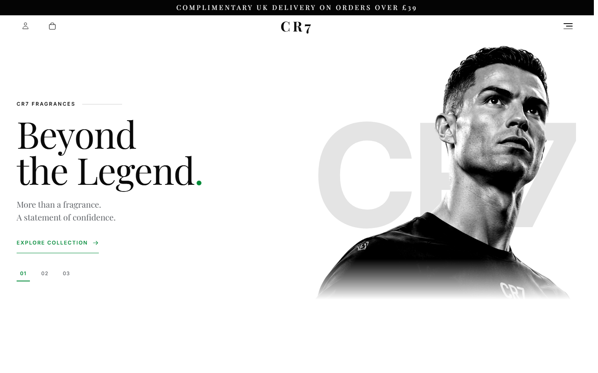
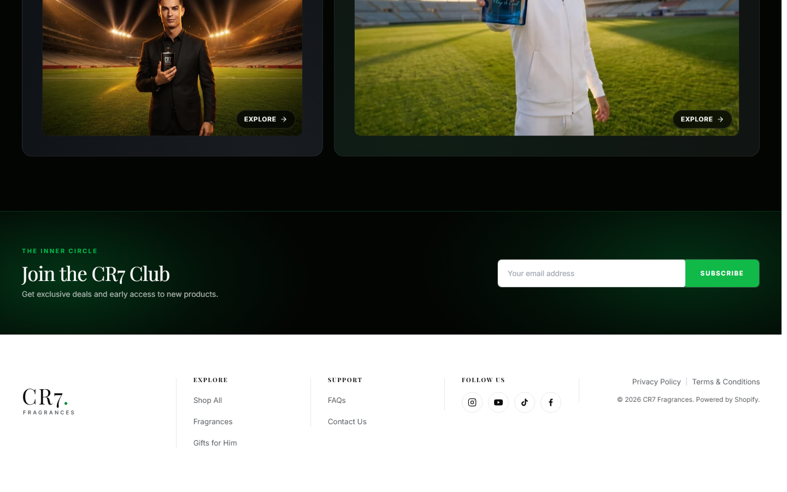
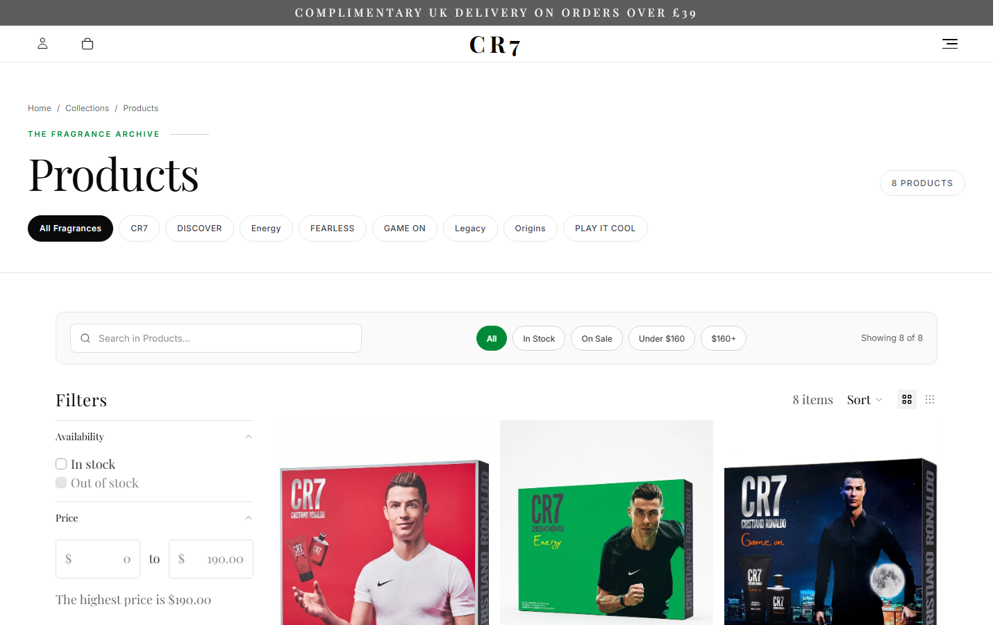
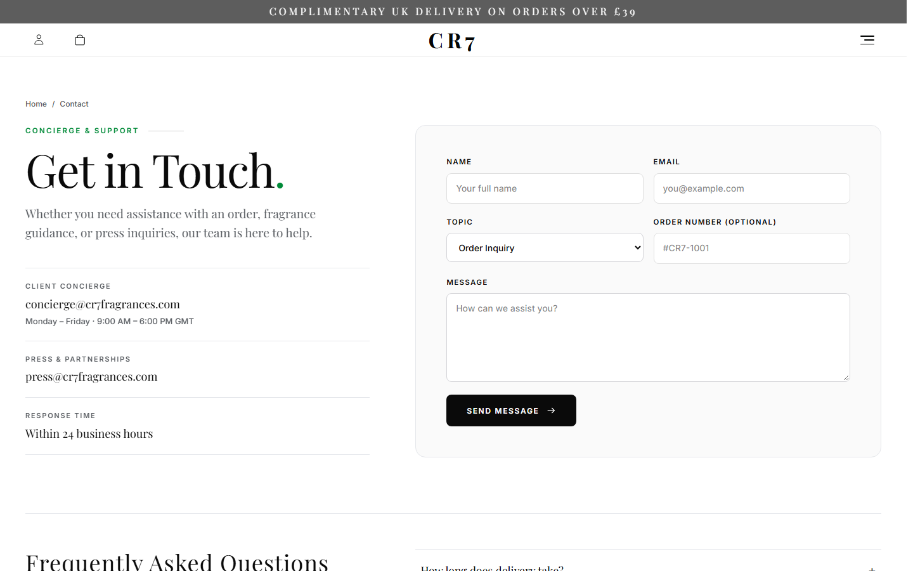
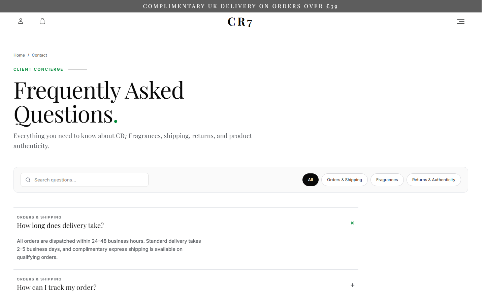
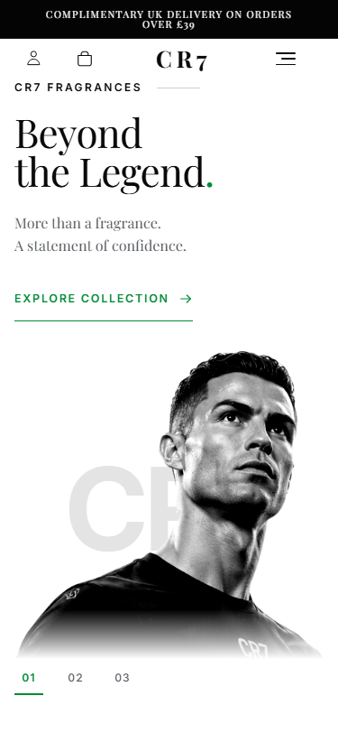

# CR7 Fragrances — Editorial Shopify Theme

A luxury editorial Shopify Online Store 2.0 theme crafted for **CR7 Fragrances**, built on a crisp `#FFFFFF` × `#0A0A0A` × `#008A38` emerald palette with `Playfair Display` display typography, `Inter` UI typography, custom transparent cutout hero visuals, interactive collection filtering, dedicated editorial pages, and site-wide scroll & text reveal animations.

**Repository:** [github.com/Robin-Ibn-Nur/cr7-fragrances-theme](https://github.com/Robin-Ibn-Nur/cr7-fragrances-theme)

---

## Visual Showcase

### Editorial Hero Slider
Full-viewport white editorial hero with numbered pagination (`01` / `02` / `03`), emerald accents, oversized `CR7` watermark, and transparent PNG cutouts framed without clipping.


### CR7 Collection Showcase
Interactive dark-card bento showcase with expandable fragrance strips, clean hover states, and responsive layout.



### Luxury Footer & CR7 Club Newsletter
Two-tier editorial footer featuring the emerald-smoked **Join the CR7 Club** newsletter banner, custom **CR7** wordmark, structured navigation columns, and social links.



### Collection Page (Search & Filtering)
Premium editorial collection experience with live search, category/price/sort controls, and clean product grid presentation.



### Minimal Contact Page
Split-column concierge layout with aligned contact details, inquiry form (`Name`, `Email`, `Topic`, `Order Number`, `Message`), and integrated smooth FAQ preview.



### Dedicated FAQ Page
Searchable, categorized FAQ page (`Orders & Shipping`, `Fragrances`, `Returns & Authenticity`) with a smooth `grid-template-rows` single-open accordion (opening one item automatically closes siblings) and direct navigation links in both the fullscreen menu and footer.



### Responsive Mobile Experience (`375px`)
Zero horizontal overflow across all templates and breakpoints (`1440px`, `768px`, `375px`).

<p align="center">
  
</p>

---

## Key Features Implemented

- **Editorial Hero Slider (`sections/cr7-hero-slider.liquid`, `assets/cr7-hero-slider.css`, `assets/cr7-hero-slider.js`)**
  - Auto-advancing carousel with `01 / 02 / 03` pagination and keyboard/pointer controls.
  - Background-removed transparent PNG cutouts (`cr7-hero-slide-1.png`, `cr7-hero-slide-2.png`, `cr7-hero-slide-3.png`) with merchant image-upload support per slide.
  - Full-viewport breathing room (`min-height: 100svh`) so the next section stays cleanly below the fold on initial load.
- **Fullscreen Navigation & Header (`snippets/cr7-fullscreen-menu.liquid`, `snippets/header-actions.liquid`)**
  - Clean transparent header with high-contrast dark foreground over light hero sections and guarded `<shopify-account>` menu attributes.
  - Fullscreen editorial menu linking to Collections, About, Contact, and FAQs.
- **Collection Search & Filter (`sections/main-collection.liquid`, `assets/cr7-collection.css`, `assets/cr7-collection.js`)**
  - Live search, sorting, and filter controls while preserving the existing product card snippet contract.
- **Minimal Contact & Concierge Page (`sections/cr7-contact.liquid`, `assets/cr7-contact.css`, `assets/cr7-contact.js`, `templates/page.contact.json`)**
  - Unified parent alignment for editorial info and Shopify contact form, plus smooth single-open accordion FAQ preview.
- **Dedicated FAQ Page (`sections/cr7-faq.liquid`, `assets/cr7-faq.css`, `assets/cr7-faq.js`, `templates/page.faq.json`)**
  - Live keyword search, category filter tabs (`All`, `Orders & Shipping`, `Fragrances`, `Returns & Authenticity`), smooth CSS grid accordion transitions, and reduced-motion support.
- **Premium Footer (`sections/cr7-footer.liquid`, `assets/cr7-footer.css`)**
  - Custom `CR7` typographic brand mark, **Join the CR7 Club** newsletter bar, and responsive multi-column layout.
- **Site-Wide Scroll & Text Animations (`assets/scroll-animations.js`, `assets/base.css`)**
  - `IntersectionObserver`-driven fade-up (`.scroll-reveal`), left/right side-slide (`.scroll-reveal--left`, `.scroll-reveal--right`), and staggered text reveals (`.scroll-reveal--text`) with `overflow-x: clip` and `prefers-reduced-motion` accessibility.

---

## Project Structure

```text
├── assets/          # Stylesheets (base.css, cr7-*.css), JS modules (scroll-animations.js, cr7-*.js), hero cutouts
├── config/          # Theme settings schema and saved settings data
├── docs/screenshots/# Storefront verification screenshots used in this README
├── layout/          # Global document shell (theme.liquid)
├── locales/         # Storefront and schema translation JSON files
├── sections/        # Modular Liquid sections (cr7-hero-slider, cr7-showcase, cr7-contact, cr7-faq, cr7-footer, etc.)
├── snippets/        # Reusable Liquid fragments (cr7-fullscreen-menu, header-actions, product-card, etc.)
└── templates/       # JSON page templates (index, collection, product, page.contact, page.faq, page.about)
```

---

## Local Development

1. Install [Shopify CLI](https://shopify.dev/docs/api/shopify-cli).
2. Clone the repository and start the local development server:
   ```bash
   git clone https://github.com/Robin-Ibn-Nur/cr7-fragrances-theme.git
   cd cr7-fragrances-theme
   shopify theme dev
   ```
3. Open `http://127.0.0.1:9292` in your browser.
